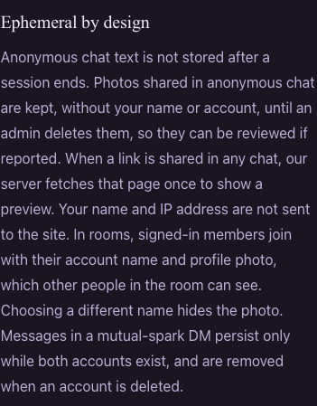

# What I’d improve on Whisper Wave

I went through the public site on mobile and desktop and compared it with Claude Opus’s earlier audit. I like the idea behind Whisper Wave. The version of the experience I found clearest was already on the site, on the Home screen. It explains who you’re talking to, how you get matched, and what happens if you want to keep in touch. I’d carry that clarity through the rest of the product.

The screenshots here are from the public site. Most mobile screenshots are from a 390 × 844 viewport.

## Homepage

- **The online count is hardcoded.** The landing page says “2,417 strangers online now,” and that exact number is in the deployed frontend bundle. The app said “Pretty quiet right now” and Rooms showed zero people. I’d remove the fixed number. If availability is shown later, I’d use recent data about whether someone can actually find a match.
- **The page should say what the product does earlier.** On mobile the headline starts about 574 px down and the main hero button starts at 773 px. The header has an earlier button, but the hero leaves the actual chat format implicit. I’d lead with “Talk to a stranger, anonymously” and explain in one sentence that it’s a live one-to-one text chat. On desktop I’d put the art beside the copy. The desktop hero button fits in a 900 px viewport and starts below a 768 px fold.
- **Give people a lower-pressure way in.** “Or just look around first” is useful, but it only shows up near the bottom. I’d move that choice up next to **Find a stranger**, with **Browse rooms** as a clear second action.
- **The landing page repeats itself.** It was about 6,400 px tall on mobile. The no-account, no-history, and leave-anytime messages recur, with big gaps between sections. On the mobile hero there’s roughly 140 px between the headline and the button. I’d keep a shorter page covering the offer, how it works, safety and privacy, common questions, and a final action.
- **Some examples look like live activity.** “The unsaid” shows aliases with timestamps such as “just now” and “2m.” The scripted walkthrough is introduced as the app “playing out live.” I’d use “Example conversation” and remove the relative timestamps.
- **The age check in the landing illustration looks tappable.** The mock checkbox and “Enter the queue” button look like working controls. I’d make the illustration clearly a sample, or give it a real link to the Whisper entry form.
- **The feature cards are hard to discover on mobile.** Most are off-screen in a carousel with tiny dots. In my capture one picker was only 6 px tall. Claude’s capture also showed the second card’s artwork as a dim, almost empty box. I’d use a short stack of cards with clear content. If the carousel stays, I’d give it visible previous and next buttons that work by keyboard.
- **Some lines read awkwardly.** Narrow headings leave single words on their own lines. The FAQ also includes “bcoz,” search-heavy phrases such as “anonymous online chat and chatting website,” and “NOT ANOTHER OMEGLE.” I’d rewrite those sections in the same direct voice as Home and check how the headings wrap at mobile widths.
- **The safety section could feel more welcoming.** The masked, hooded figure behind the FAQ brought to mind the risks people associate with stranger chat. I’d use a small example of a real safety control or a simple illustration.
- **The footer is hard to scan.** Safety appears twice. Contact and Sign in are absent in the mobile capture. I’d list Safety once and give people a direct way to reach the team and return to their account.

[See the desktop hero](whisper-wave-screenshots/desktop-homepage.jpg) · [See the clearer Home screen](whisper-wave-screenshots/app-home.jpg) · [See the landing footer](whisper-wave-screenshots/landing-footer.png)

## Visual consistency and navigation

- **The wordmark looks like “hisper Wave.”** The dark icon stands in for the W and is hard to read at small sizes. The Whisper heading’s visible text has the same problem, while its computed accessible name reads “Whisper Wave.” I’d write the complete name and use a separate, simple mark.
- **The marketing pages and app use different visual systems.** The landing page uses purple buttons with Fraunces, Hanken Grotesk, and Space Mono. The app uses green buttons with DM Serif Display and DM Sans. The landing page itself switches to the green button near the bottom. Claude counted five font families and 43 text sizes on desktop. I’d use one display font, one UI font, a small set of sizes, and one primary button style.
- **Small labels are easy to miss.** The landing page uses a lot of 9–11 px spaced-out labels. The tagline under the Whisper logo was especially small, about 7 px in the earlier audit. I’d give useful labels a more readable size and stronger contrast, and trim labels that add little.
- **The same journey has too many names.** “Find a stranger,” “Meet a stranger,” “Get it off your chest,” “Keep this vibe,” “Find someone,” and “Enter the void” send people toward the same flow. The sample adds “Enter the queue.” I’d use **Find a stranger** for links to the entry screen and **Start searching** for the action that joins the queue.
- **The mobile tabs move around.** The app shows a window of five out of seven destinations. Games and Apps scroll Home and Rooms out of view. In the Memes capture, Home stayed visible but Rooms and the current Memes tab were missing. I’d keep **Home, Rooms, Whisper, Chats, and More** in the same places and put secondary routes under More.
- **Desktop and mobile order the tabs differently.** Desktop also gives Whisper a strong highlight even when another tab is active. I’d align the order and make the current page obvious through shape or text as well as color.
- **Returning users need a visible sign-in path.** The desktop landing has a labeled Log in link. The desktop app uses a door icon with an accessible name. The mobile landing has no visible sign-in link, though Chats does. I’d use **Sign in** as a visible label in both shells and keep the helpful Chats empty state.
- **The Apps tabs have a markup issue.** The accessibility scan flagged a tab list with a link as a child that lacks the expected tab semantics. I’d use ordinary links for page navigation and proper tabs for content that switches in place.

[See the Memes tab bar](whisper-wave-screenshots/memes.jpg) · [See the Chats sign-in link](whisper-wave-screenshots/chats.jpg)

## Starting and keeping a chat

- **The required steps are buried.** I could enable the button with a valid alias and the 18+ check while leaving gender and vibes blank. I’d put those two required steps first and put the rest under **Matching preferences (optional)**.
- **Gender needs context.** I’d explain why it’s requested, how it affects matching, and what the other person can see after confirming that behavior. I’d include a **Prefer not to say** option. The current icon for “Other” looks like the male symbol.
- **The alias field could help more.** The placeholder offers examples. A **Generate alias** button would give people something they can use or edit. The field is labeled “Alias,” while the validation message calls it “Username.” I’d use the same wording and programmatically associate the error with the field.
- **The disabled button gives no reason.** I’d show “Add an alias and confirm you’re 18+” where people can see it before interacting. “Enter the void” also feels ominous for a site whose pitch is a comfortable place to talk.
- **Some form controls are small.** The gender buttons are 32 px tall, a sampled vibe chip is 25 px, and the editable part of the vibe field is 20 px. I’d aim for a 44 px hit area on priority touch controls and preserve the form’s visible input focus.
- **The waiting screen needs plain status language.** The shipped UI includes “Searching the void,” “Quiet in the void,” and a reconnecting state. I’d say whether the person is still searching or reconnecting, keep **Cancel search** available, and offer Rooms if the wait is prolonged. I’d also explain what happens when they navigate away and give partner departure and connection loss different messages. I’d only show a wait estimate when the data supports it.
- **Saving a connection has a hidden step.** The shipped mutual-match screen mentions a timer and requires sign-in to open a DM. I’d explain that before someone taps to keep the connection. I’d test what happens when sign-in finishes slowly, the connection expires, or one person backs out. I’d also verify whether earlier messages carry over and explain the result in the UI.

## Privacy and reporting

- **The privacy promise needs a little more detail.** The form says “chats vanish when you leave” and “completely anonymous.” The policy explains that ordinary guest chat text is temporary, photos have separate retention rules, reports can retain messages and context, and saved DMs persist. It also describes technical data and temporary guest identifiers. I’d explain what the other person sees and put the relevant retention information beside the entry, upload, reporting, and keep actions.
- **The public reporting page sends people to email.** It says people can report anonymously. Its fallback asks people to send an email, which usually reveals the sender’s address. The listed address is a personal Gmail account, and the grievance officer is identified by role. I’d offer an in-site guest form with optional reply details, confirm receipt, and give the team a recognizable address on the site’s domain.
- **Leaving and reporting should both be easy.** The public safety page describes Report, Block, and Safe exit, and the shipped chat UI includes reporting. I’d verify that someone can leave immediately, report and leave, or block with a clear explanation of the outcome. I’d tell the user what goes to moderators and make sure a failed submission leaves them a way to exit.
- **Safety information belongs close to the action.** Keep the published response-time commitments. Give users a direct link to them from the reporting UI and make the prose links visible without relying on color alone.

[See the email reporting fallback with the address masked](whisper-wave-screenshots/report-email.png) · [Safety page](https://whisperwave.space/safety)

## Rooms, Memes, Games, and Apps

- **Room availability mixes several different ideas.** The directory showed three open rooms and zero with people. Venting said “Waiting for a moderator” next to “Join,” while its lobby said “Always open.” I’d separate whether a room is open, whether anyone is inside, and whether a guest can post. “Be the first” is useful when a room is genuinely quiet.
- **Room schedules could be easier to read.** Late Night repeats the time zone in its opening message and schedule. The closed-room screen gives a time and a clear way back to Rooms. I’d display one schedule in the reader’s local time and handle hours that cross midnight.
- **Safe mode needs a clearer content standard.** I found a joke about homelessness and drugs in the default Safe feed. Claude saw it on the Home preview and first in the feed. It appeared second in my capture. I’d define what visitors should expect from Safe and apply that standard to both the feed and Home preview.
- **Meme images are a weak point when they load slowly.** I saw a large placeholder over readable text. A follow-up received successful image responses. The earlier capture also showed badges overlapping artwork text and long jokes squeezed into an image before the text was repeated below. I’d show a compact text card while an image is unavailable and place the category where it can’t cover the joke.
- **Report and Hide are easy to confuse.** The Report icon has an accessible name, but it’s visually unlabeled, only about 27 px wide, and next to Hide. I’d give both controls visible labels or move them into a menu with distinct actions. The audit also flagged invalid ARIA labeling on some image placeholders.
- **Games links can set expectations earlier.** Games are hosted on other sites. I’d show player count, whether sign-up is needed where verified, and which site opens before someone taps Play.
- **Whispr is easy to confuse with Whisper.** The Apps page is for anonymous notes to someone you know, while Whisper is a live conversation with a stranger. I’d lead with “Send an anonymous note” and make it clear when the link opens a different product.
- **The missing-page screen is a dead end for most tasks.** Its only action is “Return to shore.” I’d offer plain Home, Whisper, or Rooms links. The tested unknown URL also returned HTTP 200 with a visual 404. I’d return a real 404 status where the hosting setup allows.

[See Rooms on mobile](whisper-wave-screenshots/rooms.jpg) · [See the Venting lobby](whisper-wave-screenshots/venting.jpg) · [See Memes on mobile](whisper-wave-screenshots/memes.jpg)

## Pricing

- **The buying screen asks people to compare several things at once.** The ticket carousel, duration picker, and match-line demo all compete for space. I’d use one plan selector with the total price, duration, and the existing “Pay once, no auto-renewal” wording.
- **Expiry dates look more definite than they are.** The cards show “Valid until” dates before purchase. I’d explain when a plan starts and calculate the expiry after purchase. I’d verify that the chosen plan survives the Sign in to buy step.
- **The paid gender filter has a product trade-off.** Pricing says the preference broadens after 20 seconds. That belongs beside the feature. Users self-declare gender, so I’d avoid promising who a buyer will meet. Before emphasizing paid gender preferences, I’d look at wait times and repeat unwanted contact. Interest matching and ad removal are also worth considering. I’d keep reporting and blocking available for free, as Pricing already promises.
- **The pricing layout moves while loading.** I measured mobile CLS at 0.322, close to Claude’s earlier result. In a follow-up, the Match Line section moved about 449 px as the offer area settled. Desktop CLS was about 0.104. I’d reserve the plan section’s space in the initial layout and recheck on a slower connection. Safety also showed a mobile layout shift of 0.167 in my capture.

[See the settled mobile pricing screen](whisper-wave-screenshots/pricing.jpg)

## Accessibility and performance

- **Keyboard focus is difficult to see on the landing page.** The first landing links had no distinct visible focus. I also tabbed to a CTA while its parent was still transparent. I’d add a visible focus ring and a skip-to-content link, and keep the content visible when it receives focus.
- **The carousel needs a keyboard path.** The mobile scan flagged a scrollable region that users can’t focus. I’d stack the cards or make the carousel controls fully keyboard-operable and give the current item a clear state.
- **Footer and policy text need more contrast.** Five landing footer elements failed the scan, with measured ratios from 1.88:1 to 4.34:1. The same footer appears on Pricing, Safety, Privacy, and Report. Several inline policy links are also hard to distinguish. I’d meet 4.5:1 for normal text and underline inline links.
- **Some names get noisy for screen readers.** The FAQ’s accessible name includes the decorative word “Someone” before the question. The animated CTA contains several labels in the markup, although its sampled accessible name was “Find a stranger.” I’d hide decorative labels from assistive technology and check that the CTA’s name stays stable while it animates.
- **Reduced motion is a good start.** Claude measured active animations dropping from 94 to 12 with the setting on. I’d preserve that support and check focus, error messages, status announcements, and reflow on iOS, Android, and desktop. The 320 px homepage check showed no overall horizontal overflow. The internal mobile navigation and carousel still scroll sideways.
- **The homepage loads code it doesn’t need yet.** I counted 51 module preloads in the current HTML, including admin, chat, forwarding, and notification code. Claude’s earlier Lighthouse runs estimated about 150 KiB of unused JavaScript on each of the two main routes. I’d load those features when users reach them.
- **The logo and some artwork are oversized.** Claude’s responsive-image audit estimated about 399 KiB of possible savings on the landing page. The main logo was about 189 KB at 551 × 452 px, cropped to a square and shown at roughly 34 px in several places. A 1056 px secondary logo was shown at 264 px. I’d use a smaller mark and serve responsive versions of large artwork.
- **The landing page does a lot of rendering work.** Claude measured 1,188 DOM elements, 141 animated or backdrop-filtered elements in desktop Chrome, and about 2.9 seconds of main-thread work in the mobile Lighthouse run. I’d reduce overlapping blur and animation and keep important text visible without a scroll animation.
- **Several background requests need a check.** The Cloudflare analytics beacon was blocked by the site’s content security policy. Some Google Fonts connection attempts were also blocked, while fonts could load through the stylesheet path in Claude’s run. I saw a guest profile request return 401. Claude’s earlier run also saw a session refresh return 401. I’d check which analytics actually provide funnel data and avoid redundant guest requests.
- **The earlier mobile Lighthouse results give a useful starting point.** Claude recorded a performance score of 79 on the landing page and 71 on Whisper. LCP was 3.67 s and 4.69 s, respectively. The historical time-to-interactive figures were about 4.0 s and 7.3 s. These are lab readings. I’d compare fresh before-and-after runs on the same device profile and measure real visits separately.

[WCAG 2.2](https://www.w3.org/TR/WCAG22/) · [Core Web Vitals](https://web.dev/articles/vitals)

## What I’d keep and what I’d test

I’d keep the dark visual identity, the clear Home explanation, the honest quiet states, the 18+ check, the Chats empty state, and the one-off pricing language. The sampled pages generally had one main heading and descriptive metadata. I’d build on those choices.

I checked the public pages, mobile and desktop layouts, keyboard focus, the guest form before submission, and the frontend assets. I’d use controlled accounts to test matching, waiting and cancellation, reconnecting, leaving and blocking, report delivery, and the handoff from mutual interest to a saved DM. I’d verify purchases in a test environment and confirm retention behavior with the team before changing the privacy copy.

I’d like to work on this with your team. I can build the React changes, check them with a keyboard and on small screens, and measure whether more people make it from the entry screen to a conversation where both people send a message. I’d be happy to walk through any of these findings.

Ujjwal Sharma
