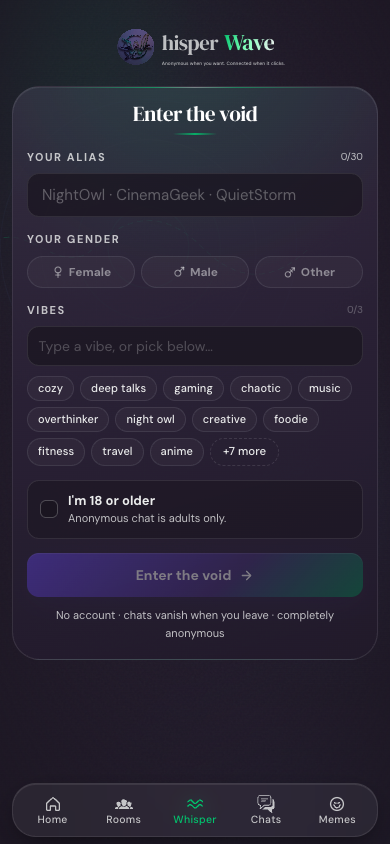

# Whisper Wave product review

I started with the mobile homepage and tried to get to the point where I could start a chat. Then I went through the public flows again with a keyboard, checked how the same pages loaded on desktop, and compared what the browser did with what the site said it would do.

Two things stood out. I chose the ₹49 weekly pass, opened Sign in, and went back to find the ₹99 monthly pass selected. On the sign-in page itself, pressing Tab took me into registration fields while the sign-in form was still on screen. Both issues are easy to miss when looking at a single screenshot.

I built a working redesign to show what I’d change. Try the shorter guest setup, browse the sample rooms, or see how the weekly pass stays selected after you go back. [Open the prototype](https://ujjwal5705.github.io/Whisperwave-improvements/) · [Read the design and growth notes](Ujjwal-Sharma-Whisper-Wave-Prototype-and-Growth.md)

The main checks took place on 22 and 23 November 2026. This page has 51 UI and UX findings. The other notes include the steps I followed, measurements, and screenshots from the public deployment. Most mobile screenshots use a 390 × 844 viewport. Live chat, authenticated access, and actual conversion rates still need site-owner data or a controlled environment.

## Test notes and findings

| Report | What I checked |
| --- | --- |
| [Public journey tests](Ujjwal-Sharma-Whisper-Wave-Public-Journey-Tests.md) | Guest entry, room search, sign-in, signup, and the handoff from pricing. |
| [Accessibility and performance](Ujjwal-Sharma-Whisper-Wave-Accessibility-and-Performance-Review.md) | Keyboard order, contrast, desktop WebKit rendering, and mobile lab measurements. |
| [SEO, logo, and colors](Ujjwal-Sharma-Whisper-Wave-SEO-and-Brand-Review.md) | A comparison of the initial HTML and rendered metadata across 22 URLs, with logo and color changes. |
| [Funnel](Ujjwal-Sharma-Whisper-Wave-Funnel-Review.md) | Two mobile entry points and the analytics calls the frontend makes along the way. |
| [Privacy and moderation](Ujjwal-Sharma-Whisper-Wave-Privacy-and-Moderation-Review.md) | Policy wording, guest reporting, cookie settings, and requests from 12 public routes. |
| [Public security](Ujjwal-Sharma-Whisper-Wave-Public-Security-Review.md) | HTTPS, browser protections, signed-out profile access, and the security contact route. |

## Homepage

- **The online count is hardcoded.** I saw “2,417 strangers online now” on the homepage and found that exact string in the deployed JavaScript. Home said “Pretty quiet right now,” and Rooms showed zero people. Remove the fixed count. If the page shows availability, use recent data about whether someone can find a match.
- **The homepage takes a while to explain the chat.** At 390 px, the headline starts 574 px down and the main button starts at 773 px. The header has a button earlier. The first clear one-line explanation belongs beside it. “Talk to a stranger, anonymously” would make sense as the headline, with live one-to-one text chat explained underneath. Put the artwork beside the copy on desktop. The current hero button fits at 900 px high and starts below a 768 px fold.
- **Let visitors look around earlier.** “Or just look around first” only shows up near the bottom. **Browse rooms** would give people a clear second option beside **Find a stranger**.
- **The landing page repeats itself.** I measured about 6,400 px of content on mobile, including roughly 140 px between the hero headline and button. The same no-account, no-history, and leave-anytime messages appear several times. A shorter page could cover what the product does, how it works, safety and privacy, common questions, and one final action.
- **Some examples look like live activity.** “The unsaid” shows aliases with timestamps such as “just now” and “2m.” The walkthrough is introduced as the app “playing out live,” even though it’s scripted. Label it **Example conversation** and remove the relative timestamps.
- **The age check in the illustration looks tappable.** The mock checkbox and “Enter the queue” button look like working controls. A clear caption would set expectations. A real link to the Whisper form would also work.
- **The feature cards are hard to find on mobile.** Most are off-screen in a carousel, and one of the dots I measured was only 6 px tall. The second card’s artwork is dim enough to look nearly empty. A vertical stack would be easier to browse. If the carousel stays, give it visible Previous and Next buttons that work with a keyboard.
- **Some headings and FAQ copy read awkwardly.** Narrow headings leave words on their own lines. The FAQ also uses “bcoz,” “anonymous online chat and chatting website,” and “NOT ANOTHER OMEGLE.” Home already has a more direct voice. Use it here and check the line breaks on narrow screens.
- **The safety artwork sends an uneasy signal.** The masked, hooded figure behind the FAQ brought to mind the risks people associate with stranger chat. A small example of a real safety control would tell visitors more about what they can do.
- **The footer is hard to scan.** Safety appears twice. I couldn’t find Contact or Sign in in the mobile capture. List Safety once and put the contact and account links where people can find them.

[See the desktop hero](whisper-wave-screenshots/desktop-homepage.jpg) · [See the clearer Home screen](whisper-wave-screenshots/app-home.jpg) · [See the landing footer](whisper-wave-screenshots/landing-footer.png)

## Visual consistency and navigation

- **The wordmark looks like “hisper Wave.”** The dark icon stands in for the W and is hard to read at small sizes. The Whisper heading’s visible text has the same problem, while its computed accessible name reads “Whisper Wave.” Write out the whole name and put the mark beside it.
- **The homepage and the app feel different.** The landing page uses purple buttons with Fraunces, Hanken Grotesk, and Space Mono. The app uses green buttons with DM Serif Display and DM Sans. The landing page even switches to a green button near the bottom. The desktop landing page uses five font families and 43 text sizes. One display font, one UI font, fewer sizes, and a shared primary button would make the two screens feel related.
- **Small labels are easy to miss.** The landing page uses a lot of 9–11 px spaced-out labels. The tagline under the Whisper logo was especially small, about 7 px in the earlier audit. Increase the size and contrast of the useful labels. Remove labels that add little.
- **The same journey has too many names.** “Find a stranger,” “Meet a stranger,” “Get it off your chest,” “Keep this vibe,” “Find someone,” and “Enter the void” send people toward the same flow. The sample adds “Enter the queue.” I’d use **Find a stranger** for links to the entry screen and **Start searching** for the action that joins the queue.
- **The mobile tabs move around.** The app shows a window of five out of seven destinations. Games and Apps scroll Home and Rooms out of view. In the Memes capture, Home stayed visible but Rooms and the current Memes tab were missing. I’d keep **Home, Rooms, Whisper, Chats, and More** in the same places and put secondary routes under More.
- **Desktop and mobile order the tabs differently.** Desktop also gives Whisper a strong highlight even when another tab is active. Keep the order the same and identify the current page with shape or text as well as color.
- **Returning users need a visible sign-in path.** The desktop landing has a labeled Log in link. The desktop app uses a door icon with an accessible name. The mobile landing has no visible sign-in link, though Chats does. Show **Sign in** as text on both the public page and the app. The Chats empty state is worth keeping.
- **The Apps tabs have a markup issue.** The accessibility scan flagged a tab list with a link as a child that lacks the expected tab semantics. Use links to move between pages and proper tabs when content switches in place.

[See the Memes tab bar](whisper-wave-screenshots/memes.jpg) · [See the Chats sign-in link](whisper-wave-screenshots/chats.jpg)

## Starting and keeping a chat

- **The required steps are buried.** I could enable the button with a valid alias and the 18+ check while leaving gender and vibes blank. Those two steps should come first. Put gender and vibes under **Matching preferences (optional)**.
- **Gender needs context.** Explain why the form asks for gender, how matching uses it, and what the other person can see. Check the actual behavior before writing that copy. Offer **Prefer not to say**. The current icon for “Other” looks like the male symbol.
- **The alias field could help more.** The placeholder offers examples. A **Generate alias** button would give people something they can use or edit. The field is labeled “Alias,” while the validation message calls it “Username.” Use **Alias** in both places and associate the error with the field in the markup.
- **The disabled button gives no reason.** Put “Add an alias and confirm you’re 18+” above the disabled button. “Enter the void” also feels ominous for a site whose pitch is a comfortable place to talk.
- **Some form controls are small.** The gender buttons are 32 px tall, a sampled vibe chip is 25 px, and the editable part of the vibe field is 20 px. Aim for a 44 px hit area on priority touch controls. Keep the visible input focus that the form already has.
- **The waiting screen needs plain status language.** The shipped UI includes “Searching the void,” “Quiet in the void,” and a reconnecting state. Say whether the app is still searching or reconnecting. Keep **Cancel search** available and offer Rooms if the wait goes on. Explain what happens when people navigate away, and distinguish a partner leaving from a connection loss. Give a wait estimate when the data supports one.
- **Saving a connection has a hidden step.** The shipped mutual-match screen mentions a timer and requires sign-in to open a DM. Show the sign-in requirement and the timer before someone chooses to keep the connection. Test slow sign-in, expiry, and either person backing out. The screen should also say whether the earlier messages carry over once that behavior is verified.

## Privacy and reporting

- **The privacy promise needs a little more detail.** The form says “chats vanish when you leave” and “completely anonymous.” The policy explains that ordinary guest chat text is temporary, photos have separate retention rules, reports can retain messages and context, and saved DMs persist. It also describes technical data and temporary guest identifiers. Explain what the other person sees when a guest starts a chat. Show the relevant retention rules when someone uploads, reports, or chooses to keep a connection.
- **The public reporting page sends people to email.** It says people can report anonymously. Its fallback asks people to send an email, which usually reveals the sender’s address. The listed address is a personal Gmail account, and the grievance officer is identified by role. A guest form could accept a report with optional reply details and show a confirmation. Use a recognizable team address on the site’s domain for email contact.
- **Leaving and reporting should both be easy.** The public safety page describes Report, Block, and Safe exit, and the shipped chat UI includes reporting. Test immediate exit, report and leave, and blocking as distinct actions. Explain what goes to moderators and keep an exit available after a failed report.
- **Safety information belongs close to the action.** Keep the published response-time commitments. Give users a direct link to them from the reporting UI and make the prose links visible without relying on color alone.

[See the email reporting fallback with the address masked](whisper-wave-screenshots/report-email.png) · [Safety page](https://whisperwave.space/safety)

## Rooms, Memes, Games, and Apps

- **Room availability mixes several different ideas.** The directory showed three open rooms and zero with people. Venting said “Waiting for a moderator” next to “Join,” while its lobby said “Always open.” Those labels should answer three separate questions about opening hours, occupancy, and whether a guest can post. “Be the first” is useful when a room is genuinely quiet.
- **Room schedules could be easier to read.** Late Night repeats the time zone in its opening message and schedule. The closed-room screen gives a time and a clear way back to Rooms. One schedule in the reader’s time zone would be easier to read. Check how it displays when hours cross midnight.
- **Safe mode needs a clearer content standard.** A joke about homelessness and drugs appeared in the Home preview and near the top of the default Safe feed. Its exact position varied between checks. Define what Safe means and apply it to both places.
- **Meme images are a weak point when they load slowly.** I saw a large placeholder over readable text. A follow-up received successful image responses. The earlier capture also showed badges overlapping artwork text and long jokes squeezed into an image before the text was repeated below. Use a compact text card while the image is unavailable. Give the category a spot where it can’t cover the joke.
- **Report and Hide are easy to confuse.** The Report icon has an accessible name, but it’s visually unlabeled, only about 27 px wide, and next to Hide. Give both controls visible labels, or put distinct actions in a menu. The audit also flagged invalid ARIA labeling on some image placeholders.
- **Games links can set expectations earlier.** Games are hosted on other sites. Before people tap Play, show player count, which site opens, and whether it needs sign-up when that’s known.
- **Whispr is easy to confuse with Whisper.** The Apps page is for anonymous notes to someone you know, while Whisper is a live conversation with a stranger. “Send an anonymous note” would make the difference clear. Name the product that opens when the link is followed.
- **The missing-page screen is a dead end for most tasks.** Its only action is “Return to shore.” Give people clear links to Home, Whisper, or Rooms. The tested unknown URL returned HTTP 200 with a visual 404. Return a real 404 status where the hosting setup allows.

[See Rooms on mobile](whisper-wave-screenshots/rooms.jpg) · [See the Venting lobby](whisper-wave-screenshots/venting.jpg) · [See Memes on mobile](whisper-wave-screenshots/memes.jpg)

## Pricing

- **The buying screen asks people to compare several things at once.** The ticket carousel, duration picker, and match-line demo all compete for space. A single selector can show the total price, duration, and the existing “Pay once, no auto-renewal” copy.
- **Expiry dates look more definite than they are.** The cards show “Valid until” dates before purchase. Explain when the plan starts and calculate its expiry after purchase. Test that the chosen plan survives the sign-in step.
- **The paid gender filter has a product trade-off.** Pricing says the preference broadens after 20 seconds. That belongs beside the feature. Users self-declare gender, so I’d avoid promising who a buyer will meet. Before emphasizing paid gender preferences, I’d look at wait times and repeat unwanted contact. Interest matching and ad removal are also worth considering. Keep reporting and blocking free, as Pricing already promises.
- **The pricing layout moves while loading.** The mobile CLS was 0.322 on repeated checks. In one run, the Match Line section moved about 449 px as the offer area settled. Desktop CLS was about 0.104. Reserve enough space for the plans to load without moving the next section, then recheck on a slower connection. The Safety page had a mobile CLS of 0.167 too.

[See the settled mobile pricing screen](whisper-wave-screenshots/pricing.jpg)

## Accessibility and performance

- **Keyboard focus is difficult to see on the landing page.** The first landing links had no distinct visible focus. I also tabbed to a CTA while its parent was still transparent. Add a visible focus ring and a skip-to-content link. Reveal content as soon as it receives focus.
- **The carousel needs a keyboard path.** The mobile scan flagged a scrollable region that users can’t focus. I’d stack the cards or make the carousel controls fully keyboard-operable and give the current item a clear state.
- **Footer and policy text need more contrast.** Five landing footer elements failed the scan, with measured ratios from 1.88:1 to 4.34:1. The same footer appears on Pricing, Safety, Privacy, and Report. Several inline policy links are also hard to distinguish. Aim for at least 4.5:1 for normal text. Underline inline links.
- **Some names get noisy for screen readers.** The FAQ’s accessible name includes the decorative word “Someone” before the question. The animated CTA contains several labels in the markup, although its sampled accessible name was “Find a stranger.” Hide the decorative prefix from assistive technology. Check that the button keeps a stable name during the animation.
- **Reduced motion already helps.** In the earlier browser check, the number of active animations dropped from 94 to 12 with the setting enabled. I’d keep that support and check focus, errors, status announcements, and reflow on iOS, Android, and desktop. The homepage fit at 320 px without horizontal page scroll. Some controls inside the app and the homepage carousel still scroll sideways.
- **The homepage loads code it doesn’t need yet.** I counted 51 module preloads in the HTML, including admin, chat, forwarding, and notification code. Earlier Lighthouse runs estimated about 150 KiB of unused JavaScript on each of the two main routes. Load those features when people reach them.
- **The logo and some artwork are oversized.** Lighthouse estimated about 399 KiB of possible image savings on the landing page. The main logo was about 189 KB at 551 × 452 px, cropped to a square and shown at roughly 34 px in several places. A 1056 px secondary logo was shown at 264 px. Serve a smaller image for each size.
- **The landing page does a lot of rendering work.** The desktop check found 1,188 DOM elements and 141 with animation or backdrop filters. The mobile Lighthouse run showed about 2.9 seconds of main-thread work. Reduce overlapping blur and animation. Keep important text visible as the page loads.
- **Several background requests need a check.** The site’s content security policy blocked the Cloudflare analytics beacon and some Google Fonts connection attempts. The stylesheet path still loaded fonts in the earlier check. A guest profile request returned 401, and the earlier check also showed a session refresh returning 401. Check whether funnel events reach the intended analytics tool. Cut out redundant guest requests.
- **The earlier mobile Lighthouse runs were slow on the first screen.** The landing page scored 79 with an LCP of 3.67 s. Whisper scored 71 with an LCP of 4.69 s. Time to interactive was about 4.0 s and 7.3 s, respectively. These are lab readings. Use the same lab settings before and after each change. Track real visits separately.

[WCAG 2.2](https://www.w3.org/TR/WCAG22/) · [Core Web Vitals](https://web.dev/articles/vitals)

## What I’d keep and what I’d fix first

Home explains the chat well. The dark visual identity, honest quiet states, 18+ check, Chats empty state, and one-off pricing language are worth keeping. Most of the pages I sampled had one main heading and descriptive metadata.

I’d start with three changes in the React app. Put the alias and age check together, keep only the visible auth form in the tab order, and carry the selected pass through the trip to Sign in and back. I’d rerun the same checks on a small screen and with a keyboard. Once tracking is working, I’d measure how many people reach a conversation where both participants send a message.

The next checks need controlled accounts. That includes matching, waiting and cancellation, reconnecting, leaving and blocking, report delivery, and the handoff from mutual interest to a saved DM. Purchases need a sandbox. Confirm the retention rules with the team before updating what the site promises.

Ujjwal Sharma
