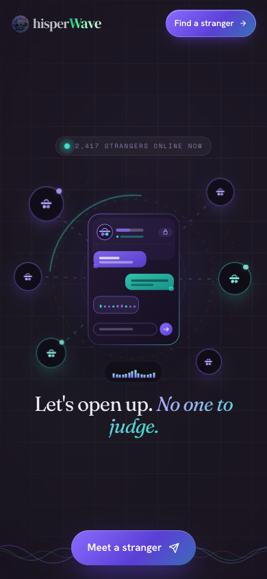
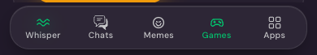

# A few things I’d improve on Whisper Wave

I spent some time going through Whisper Wave at a mobile screen size. The Home page explains the idea well. Pick a name, match with someone, and keep talking if it clicks. I’d bring that same clarity to the public homepage and the screens people go through before their first chat.

## Make the homepage easier to understand

My first impression was that the illustration got more space than the explanation. The main button sits near the bottom of the screen. I’d lead with **Talk to a stranger, anonymously**, explain that it’s a live one-to-one text chat, and put **Find a stranger** and **Browse rooms** right there. I’d also remove the hardcoded “2,417 strangers online now” count. It sets an expectation about how quickly someone will find a match.

## Make it easier to start a chat

I could enable the button with an alias and the 18+ checkbox alone. The form gives gender and vibes a lot of space, so they look required. I’d put the two required steps first, move the rest under **Matching preferences (optional)**, and offer a nickname people can change. I’d call the button **Start searching** so people know they’re entering a queue.

## Make Home and Sign in easy to find

On Games, Home and Rooms scroll out of the bottom bar. The mobile homepage also has no sign-in link. I’d keep **Home, Rooms, Whisper, Chats, and More** in the same places across the app, move Games and Memes under More, and put **Sign in** on the mobile homepage.

## Be clearer about what stays private

The chat form says chats vanish when you leave. The privacy page explains that photos and saved DMs have different rules, and the safety page says reports can retain messages and context. I’d put a short explanation on the form, explain photo retention before upload, and tell people what gets saved when they choose to keep a connection.

I also found two smaller fixes I could help with. Keyboard focus can land on a homepage link before it’s visible, and the pricing page shifts as the plans load. I’d keep links visible when focused, add a clear focus ring, and reserve space for the pricing content.

I’d like to work on these changes with your team. I can build them in React and check the result on small screens and with a keyboard. I’d be happy to walk you through what I found.

Ujjwal Sharma
