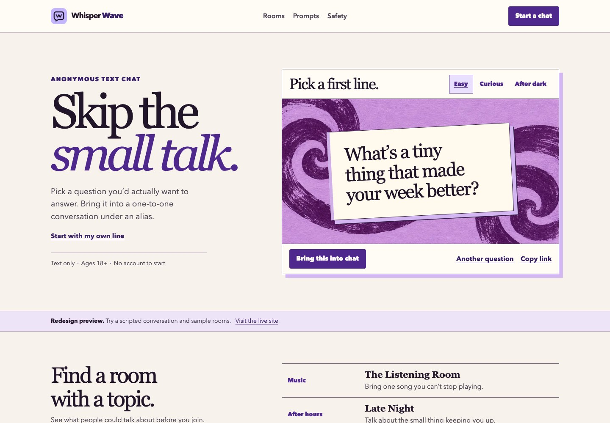
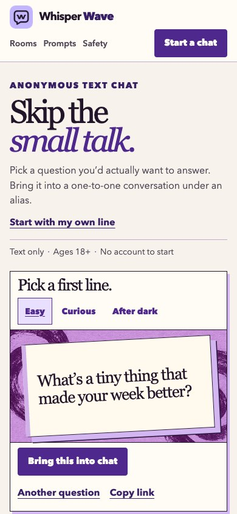
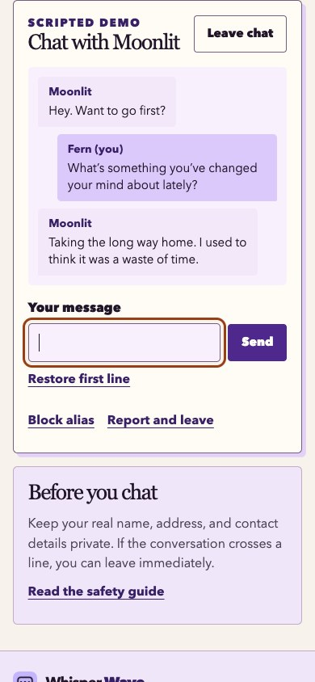

# A better opening line for Whisper Wave

[Open the working prototype](https://ujjwal5705.github.io/Whisperwave-improvements/) · [Download the new logo mark](docs/assets/whisper-wave-mark.png) · [Browse the frontend files](docs/)

The original review showed how much work it took to get to the guest form. There’s another hurdle after that. Two people can match and still have no idea what to say. I put a small deck of opening questions on the homepage so someone can try the idea before joining a chat. Pick a mood, find a line you like, and take it with you.

## What changed in the frontend

- **Homepage.** Easy, Curious, and After dark each have two original questions. A visitor can spin through the questions, copy a link to one, or start a chat with their own line.
- **Guest setup and waiting.** An alias and the 18+ check are enough to proceed. The alias suggestion is editable. Topic preferences are optional. The waiting screen offers cancellation and a path to Rooms. It keeps the alias and topic if someone cancels.
- **Conversation and safety.** Leave, Block, and Report are separate actions. The report form says what the demo sends and shows a receipt after it clears the chat. In a live version, I’d require the report copy to match the actual evidence collected and retention policy.
- **Rooms.** Search the sample rooms by topic, read their rules, and carry a topic into one-to-one chat. A quiet room still gives visitors something to read and an idea of what they could talk about.
- **Prompts.** The shared link opens the same question and mood. When a guest chooses to bring a question into chat, it appears in the composer as an editable draft. The demo partner has a different scripted answer for each question.
- **Spark Pass.** The two prices use native radio buttons. The chosen plan stays visible at the mock sign-in handoff and survives browser Back and reload.
- **Page metadata.** Each route sends its own title, description, and readable content in HTML. The GitHub preview carries `noindex` so it can be shared without competing with the live site in search.

| Mobile homepage | Mobile demo chat |
| --- | --- |
|  |  |

The demo is HTML, CSS, and JavaScript with no build step. It uses scripted replies and room examples. No live matching, user accounts, payment, report delivery, or analytics are connected. To run the source locally, serve `docs/` with any static HTTP server and open its homepage.

I checked the prototype in Chromium at 1440, 390, and 320 px. I used the keyboard to change moods, reopened a copied question link, and verified that the opener stayed a draft until I sent it. I also rechecked queue cancellation, the report dialog, and the pass selection after Back and reload. The automated axe scan reported zero violations on the seven main pages in the sampled states.

## The new logo and palette

The mark combines a W-shaped wave with a speech bubble. The header spells out **Whisper Wave** next to it, so the mark can work on its own in a small tab without taking a letter out of the name. The [1024 px mark](docs/assets/whisper-wave-mark.png) and [64 px favicon](docs/assets/whisper-wave-mark-64.png) use the same shape.

I used the violet identity as ink on a paper-colored interface. Deep violet `#4F288E` handles the main actions, warm paper `#F7F2EB` keeps reading areas quiet, and rust `#983F15` marks keyboard focus. The opening deck is based on a note passed across a table. The two printed waves frame it without competing with the question. The same visual choices carry through chat, rooms, and pricing. The [brand review](Ujjwal-Sharma-Whisper-Wave-SEO-and-Brand-Review.md) also covers how the current site could simplify its dark palette.

## What I’d borrow from other products

I compared what the public pages made easy to understand. The useful ideas were the steps they put in front of a visitor and the choices they left optional.

| Product | What I saw | How I’d use it in Whisper Wave |
| --- | --- | --- |
| StrangerMeetup | The chat page explains the difference between a private chat and group rooms, then links to both. It also links to guides about starting conversations. [Chat with Strangers](https://strangermeetup.com/chat-with-strangers) | Give **Start a chat** and **Browse rooms** clear destinations. Put a usable prompt on a guide page so a reader can try it immediately. |
| Emerald Chat | The public page shows shared interests like Music and Reading as reasons people were connected. [Emerald Chat](https://emeraldchat.com/) | Ask for one topic at most during guest entry. Once a match is real, tell both people what they have in common. When the queue is quiet, make broadening optional and show the consequences before it happens. |
| Slowly | Its auto-match flow asks someone to begin with a topic and a question before matching. [Slowly Auto-match](https://help.slowly.app/hc/en-us/articles/115001829031-How-to-match-a-pen-pal-through-Auto-match) | Bring a question along if someone already picked one. Offer a shared starter in chat when both people are unsure what to say. Let either person skip it. |
| Discord | Forum channels organize conversations by topic. They support tags, posting guidelines, and permissions for creating and moderating discussions. [Discord Forum Channels](https://support.discord.com/hc/en-us/articles/6208479917079-Forum-Channels-FAQ) | Give each room a purpose and rules that are visible before joining. For a hosted room, show when the host will actually be there and what guests can do between sessions. |

## Where I’d look for qualified traffic

### Give people a useful page before they join the queue

Start with pages that match a distinct reason for visiting. The homepage can target anonymous text chat, Rooms can answer what people talk about and how moderation works, and a conversation-starters page can serve people looking for something to say. A music page could include a short guide to trading recommendations, original prompts, and a way into a music chat. Make a dedicated page only when there’s enough substance to give a visitor a reason to stay.

Serve the content and one canonical per route in the first response. Make links between the guides, room previews, and chat usable without JavaScript. Add the pages to the sitemap once the content and actions work end to end. The first-response problem in the audit is worth fixing before creating more pages. [Google’s JavaScript SEO guide](https://developers.google.com/search/docs/crawling-indexing/javascript/javascript-seo-basics) · [Google’s helpful content guidance](https://developers.google.com/search/docs/fundamentals/creating-helpful-content)

### Let someone share the question they came for

The prompt link is the idea I’d test first. A person can send “What’s a tiny thing that made your week better?” to a friend or include it in a group post. The recipient can read it without signing in. From there they can reuse the prompt, explore the same topic, or do nothing.

The prototype copies a link to the question card. A production version could give the strongest prompts their own URL and preview card. Keep the card about the prompt. Never put a stranger’s alias, messages, or conversation ID in a share link. Measure whether recipients actually use a prompt and reach a conversation, then compare that with people arriving from ordinary shared homepage links.

### Bring a small community in at the same time

A quiet queue is hard to fix one visitor at a time. I’d try a hosted Listening Room with a small music community whose members already trade playlists. Give the host a shareable page with the session topic, local time, rules, and a prompt people can answer beforehand. Two people who arrive together can get a better experience than ten visitors spread across a day. The same idea could work for a co-op gaming community. The host needs moderation tools and a way to mark a session canceled or full.

Start with one or two rooms and compare hosted visits with similar visits outside a session. Check attendance, whether guests get a reply, whether they come back, and what moderation took. Share through partners who have agreed to host and communities that welcome the link.

### Try a small change after the match

A shared question at the start of a chat could make the first thirty seconds easier. I’d test one card both people can answer or skip. People who chose a topic could get a question related to it. People who leave the choice open could get a general one. If it helps matches turn into conversations, organizers could share the same starter when inviting people into a hosted room. This idea is about getting more value from the traffic that shows up, especially on a quiet day.

## How I’d know the changes worked

| Question | What to measure |
| --- | --- |
| Does search send the right visitors? | Query impressions and clicks in Search Console, then the share of visits to each landing page that reach the guest form and a two-way conversation. |
| Do prompt links bring anyone back? | Prompt links copied, visits through those links, prompt use, and two-way chats from those visits. Treat copied links as intent since some never get shared. |
| Do hosted rooms solve a real problem? | Arrivals per session, share of guests who get a reply, time to first reply, return visits, and moderator workload. |
| Does a shared prompt help a match turn into chat? | Share of matches where both people send a message, time to the first message, skips, and early exits. Compare with similar matches without a prompt. |
| Is the experience still safe and usable? | Wait and cancellation, failed messages, reports per conversation, and report completion. Include sample sizes and compare visitors under similar queue conditions. A change in reports can also reflect a better reporting control. |

The outcome I care about is a first conversation where both people send a message. Search visits and link clicks are steps toward it. I’d record the entry page, topic key, and attempt outcome, with short-lived IDs for deduplication. That’s enough to check the funnel without collecting aliases or message text. The public audit gives me evidence for the proposed changes. It doesn’t give me real conversion rates, keyword demand, or evidence that these ideas will grow traffic.

Ujjwal Sharma
